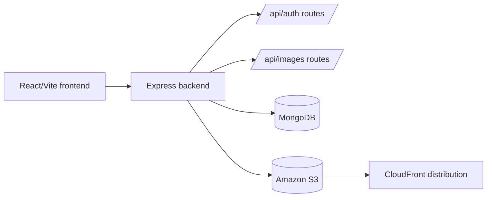

# S3 + CloudFront Image Integration

A TypeScript full-stack image-upload application. The Vite/React frontend authenticates users and manages images through an Express backend; the backend persists metadata in MongoDB and integrates with S3/CloudFront services through its service layer.

## Architecture



`backend/index.ts` configures CORS, JSON parsing, database startup, auth/image routes, and error handling. `backend/src/` contains configuration, middleware, models, controllers, and routes. `frontend/` is a React 19/Vite client.

## Setup

```bash
cd backend && npm ci
cp .env.example .env
npm run dev

# in another shell
cd frontend && npm ci
cp .env.example .env
npm run dev
```

Set MongoDB, S3 bucket/region/credentials, CloudFront distribution details, JWT/session settings, and `FRONTEND_URL` in the appropriate environment files. Never expose AWS secret keys to the frontend.

## API

`GET /` is a health/version response. Authentication is mounted at `/api/auth`; image operations are mounted at `/api/images`. Use the route/controller implementations as the source of truth for request schemas and authorization.

## Deployment

Build the frontend with `npm run build` and deploy its static output behind CloudFront. Run the backend as a Node.js service, restrict S3 access to the service role, configure CORS to the deployed frontend origin, and use signed URLs or equivalent least-privilege access.

## Testing and limitations

The manifests provide frontend lint/build scripts but no complete integration suite. Test login, token expiry, upload size/type validation, S3 failures, CDN cache invalidation, and unauthorized image access.

## Security and operations

- Keep credentials, database URLs, OAuth tokens, API keys, and signing secrets in environment variables; never commit them.
- Validate and constrain uploaded files and user input at the server boundary, and enable HTTPS in production.
- Review dependency updates and rotate any credential that has appeared in repository history.

## Testing

The repository currently has no comprehensive automated test suite unless noted above. Before production changes, add tests for authentication/authorization, validation failures, persistence errors, and the primary user workflow.

## Limitations and roadmap

This is an actively evolving project. Production hardening, observability, rate limiting, backup/retention policy, and accessibility/performance validation should be completed before handling sensitive or high-volume workloads.

## License

See the repository license file and package metadata for the authoritative terms.
